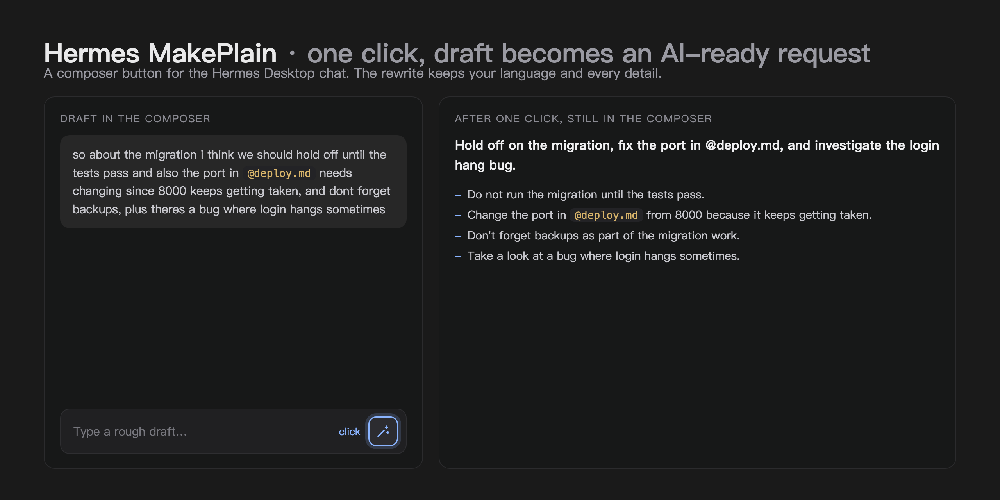

  English | <a href="README.zh-CN.md">简体中文</a>

  

<h1 align="center">Hermes MakePlain</h1>

  <em>One click turns your rough draft into a message an AI can act on:
  one goal line, then one request per line.</em>

## What it does

- Adds a wand button to the right of the chat input box in Hermes Desktop.
- Click it to replace your rough draft in place with a clean, AI-ready rewrite. The message is not sent; the chat stays untouched.
- The output format is made for AI agents.
- The rewrite stays in the language you wrote in, and keeps every concrete detail exactly as written: names, numbers, versions, ports, paths, file names, URLs, `@`-references, `/`-commands and code.
- You can see what it is doing: the button spins while the rewrite is in flight, and an empty box is rejected before any work starts.

## How it works

Each click sends the draft text to the model configured for `auxiliary.title_generation` in the Hermes config, through Hermes' built-in auxiliary route. That route is intended for cheap, fast helper calls and does not touch your main chat model.

## Install

Copy `plugin.yaml` and `desktop/plugin.js` into the desktop plugins folder (`~/.hermes/desktop-plugins/` on macOS and Linux) as `hermes-make-plain/`, then run "Reload desktop plugins" from the command palette (⌘K). The button appears immediately.

From the plugin catalog: install `hermes-make-plain`, then flip its Desktop switch in Settings → Plugins. A catalog install ships the desktop half switched off until you toggle it.

## Disclosure

- One model call per click: the draft text is sent to the model configured under `auxiliary.title_generation` to produce the rewrite.
- No other network calls, no telemetry, no analytics.
- The plugin reads and writes only the composer draft through the official SDK. Its whole storage is a one-field load heartbeat; it keeps no copy of your text.

## Requirements

Hermes Desktop 0.22.0 or newer.

## License

MIT, see [LICENSE](LICENSE). Version history lives in [CHANGELOG.md](CHANGELOG.md).
