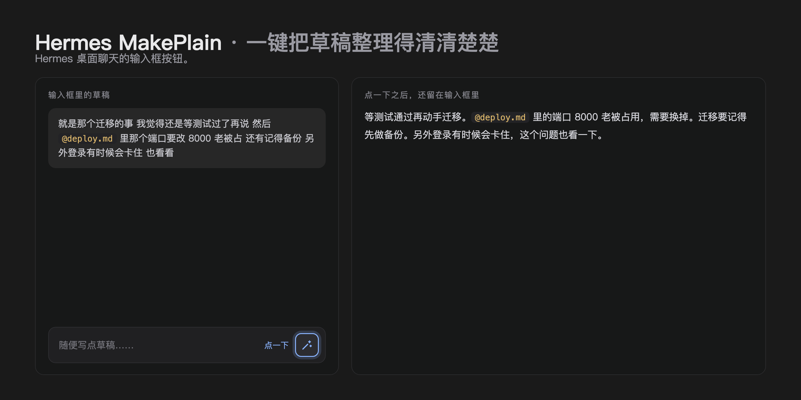

  <a href="README.md">English</a> | 简体中文

  

<h1 align="center">Hermes MakePlain</h1>

  <em>一键把草稿整理得清清楚楚：
  意思不变，语言不变，细节不丢。</em>

## 它做什么

- 在 Hermes 桌面聊天的输入框右侧加一个魔杖按钮。
- 点一下，就地把草稿替换成干净、更好读的版本。消息不发送，对话不被改动。
- 重写不改变你的意思，保持草稿原有语言，细节都原样保留：名字、数字、版本、端口、路径、文件名、URL、`@` 引用、`/` 命令、代码和行内代码。
- 做了什么一眼可见：重写进行中按钮会转圈，输入框为空会在开始前拦下。

## 工作原理

每点一次，草稿文本会通过 Hermes 内置的 auxiliary 通道发给配置里 `auxiliary.title_generation` 指向的模型。这条通道是给便宜、快速的辅助调用用的，不动你主对话用的模型。

## 安装

把 `plugin.yaml` 和 `desktop/plugin.js` 复制到桌面插件目录（macOS 和 Linux 是 `~/.hermes/desktop-plugins/`），目录名 `hermes-make-plain/`，然后在命令面板（⌘K）执行 Reload desktop plugins。按钮会立刻出现。

从插件市场安装：装好 `hermes-make-plain` 后，到 Settings → Plugins 里打开它的 Desktop 开关。市场安装的桌面半边默认是关的，需要手动开。

## 说明

- 每次点击一次模型调用：草稿文本发给 `auxiliary.title_generation` 配置的模型来生成重写结果。
- 没有其他网络调用，没有遥测，没有统计。
- 插件只通过官方 SDK 读写输入框草稿。它保存的全部内容是一个心跳键，不保留你的文本副本。

## 要求

Hermes Desktop 0.22.0 或更新版本。

## 许可

MIT，见 [LICENSE](LICENSE)。版本历史在 [CHANGELOG.md](CHANGELOG.md)。
